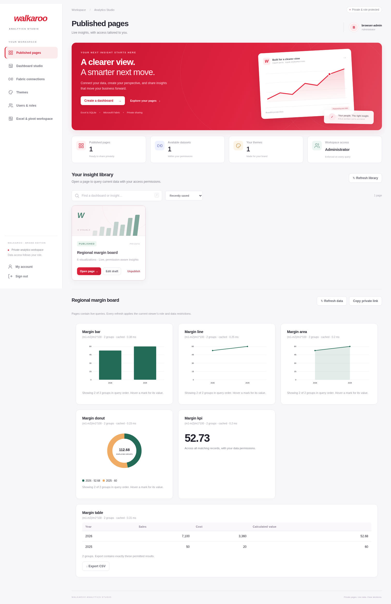
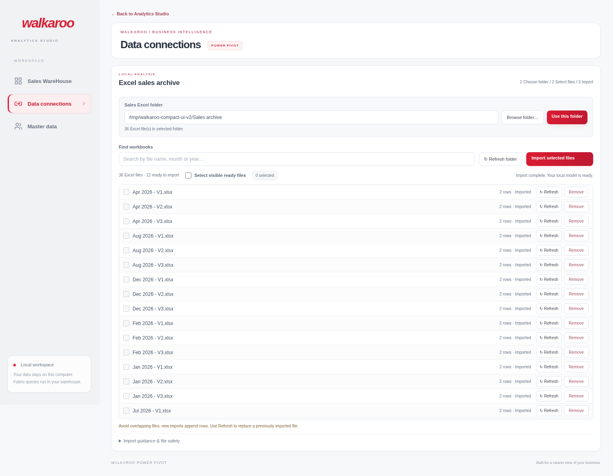
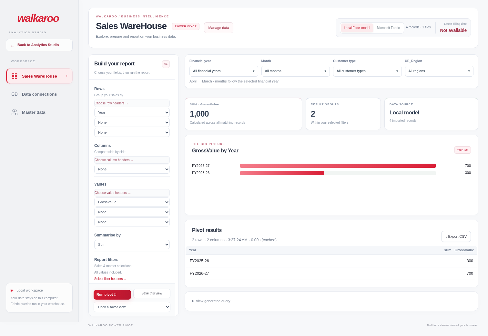

# Walkaroo — latest final app

**Use [WALKAROO-FINAL.zip](https://github.com/jumanshakir-alan/walkaroo-pivot/blob/deliver/walkaroo-final-20261030/WALKAROO-FINAL.zip).**

Latest UI update (31 October 2026): Back to Analytics Studio is below the logo in the sidebar. The report builder keeps Run/Save reachable and uses clearer field, filter and result layouts. The compact Data connections list remains included. [UI-only update for existing installs](WALKAROO-UI-UPDATE.zip).

This is the complete latest package, including the logo URL, red/white/charcoal redesign, folder picker, dashboards, Fabric connector options and role permissions. Older ZIPs are retained as previous versions; they are not needed for this installation.

## Download and start

1. Open **WALKAROO-FINAL.zip** above and click **Download raw file** (downward-arrow button).
2. Extract it. Run **SETUP WALKAROO.cmd** once.
3. Run **START WALKAROO.cmd**. It opens the updated portal at **http://127.0.0.1:8870/**.
4. Follow **READ FIRST.txt** for first administrator setup and data import.

To keep your existing accounts and sales, stop the app, back up the old installation, and merge the new **application** folder into the existing one, replacing application files. Keep your **application/data** and **.venv** folders. The ZIP contains no database/account files. Restart the updated portal and press **Ctrl+F5**.

## Included

- Supplied Walkaroo logo URL with optional local cache and offline text fallback.
- Redesigned sign-in, navigation, dashboard library, search, sorting and mobile layouts.
- Dashboard studio, six visualization types, aggregate formulas and private publishing.
- Theme creation, user management, roles and UP_Region / Budget Category / Business Type restrictions.
- Both Fabric sign-in choices, test connection and multiple readable datasets.
- Browse folder, pasted folder path, saved source selection and existing Excel/master/pivot workflow.

The original 56 supplied files remain byte-identical. Validation: **91 Python tests, six JavaScript scripts, and Chromium workflow checks passed**. Live Fabric and Windows-specific behavior still need acceptance with your actual driver, endpoint and account. The logo JPEG could not be fetched by the cloud build host; setup can cache it on your computer, otherwise your browser loads the supplied online URL.

## UI preview

Synthetic test data is shown below. The preview uses the offline text logo fallback; the app is configured with the supplied official image URL.

## Compact Data connections

Synthetic workbook data is shown in this UI preview.

## Report workspace

Synthetic data is shown; the logo uses its offline text fallback in this cloud preview.

